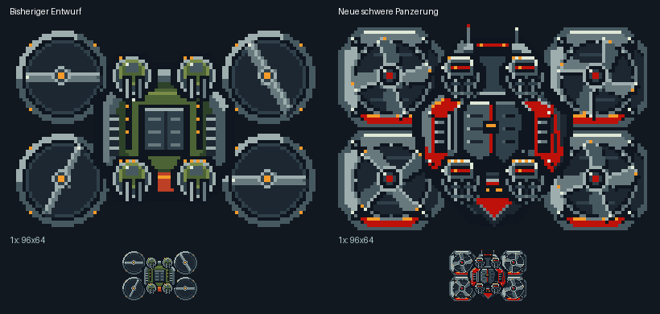

# Level-1-Boss – detaillierte schwere Fassung

Überarbeitung des Bosses aus PR #14, Ausgangscommit
`b2f2a30be697a487d5a118039aef9ad2e81d10d0`.



Der neue Rumpf hat eine längere kantige Silhouette, gestaffelte Stahlpanzerung,
rote Schulterplatten, hydraulische Streben, Lüftungsrippen, Verschraubungen,
Sensorleiste, Antennen und einen scharf zulaufenden Bug. Die Triebwerksgehäuse
haben segmentierte Achtkant-Panzerung, Lagerkränze und Wartungsdetails.
Vier geschwungene Rotorblätter ersetzen die dünnen Zweiblatt-Balken; weiterhin
drei echte Rotationsphasen, nun 0/30/60 Grad bei vierfacher Rotorsymmetrie.

Die Geschütztürme tragen schwere gepanzerte Doppelkanonen mit Laufringen,
dunklen Mündungen und roten Zieloptiken. Die vier individuellen Markierungen
und getrennten Turm-IDs bleiben erhalten. Die zerstörten Türme zeigen verbogene
Bauteile und Glut. Der freigelegte Kern bekommt abgerissene Panzerplatten,
einen mechanischen Rahmen und einen klar lesbaren Energiezylinder.

Die Metall-/Rotlack-Kombination orientiert sich am bisherigen Panzerflugzeug.
Einzige Palettenänderung: **Index 11 ist jetzt RGB (189,17,10)**, identisch mit
dessen kräftigem Rot. Die anderen 15 Einträge bleiben erhalten. Körper und
sämtliche Teile verwenden weiterhin genau eine Palette mit maximal 15 Farben
plus Transparenz. Beim Import die aktualisierte Palette zusammen mit den
Grafiken übernehmen. Keine Schattenfarbe wurde transparent gemacht.

## Unveränderter Integrationsvertrag

- Rumpf-Zeichenfläche 96×64, Front nach unten.
- Vier getrennte 16×16-Türme, je Süden/Südosten/zerstört.
- Turm-IDs und Offsets (30,8), (50,8), (30,40), (50,40).
- Vier visuelle Rotor-Instanzen, weiterhin 32×32 und drei geteilte Phasen.
- Kern-Overlay, Trefferrechteck und Zustandsfolge unverändert:
  erst alle vier Türme zerstören, danach den Rumpf besiegen.
- 19 Einzelgrafiken; identische Frame-Reihenfolge, Dimensionen, Binäroffsets
  und lokale RRB-Glyphenbasen. Keine neuen Teile, Frames oder Laufzeitadressen.
- **137 bewachte Glyphen = 8768 Byte**, mit 48-Byte-Palette **8816 Byte**.
  Damit bleibt der Satz unter 9 KiB und sogar unter 9000 Byte.

Die alten Maße/Layoutdaten und das vorherige Vorschaubild liegen zur
Nachvollziehbarkeit unter `source/previous-*`. Die eigentliche neue Grafik
wird direkt aus der bearbeitbaren nativen Pixelgeometrie erzeugt, nicht aus
einem skalierten oder nachträglich quantisierten KI-Bild.

```sh
python tools/export_boss_level1.py
python tools/check_boss_detail.py
```

Die zweite Prüfung verwendet den bereits vorhandenen unabhängigen Boss-Prüfer
aus `tools/check_screen_boss_art.py` und ergänzt Layout-/Kompatibilitätsprüfungen
gegen die archivierte Vorfassung. Geprüft: geschlossener Rumpf, Palette/Alpha,
alle vier Turmzustände/-positionen, Rotoranimation, Komponentenkomposition,
NCM-/FCM-/RRB-Rücktests, Dateihashes, gleiches Budget sowie bytegleich
reproduzierbarer Export. Titel- und Game-Over-Grafiken werden nicht verändert.

Weiterhin ein Artwork-Satz: **noch nicht im Spiel integriert oder auf Hardware
getestet**. Die bestehende Boss-/Screen-Dokumentation gilt für den Import weiter.
