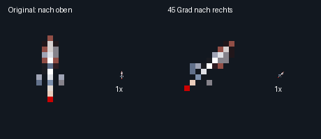

# Raketenprojektil: zusätzliche Ansicht um 45° nach rechts



Die vorhandene Spiel-Rakete zeigt nach oben. `rocket_right45.png` zeigt dieselbe
Rakete um **45° im Uhrzeigersinn nach rechts** gedreht. Beide Frames sind 16×16.
Das Shop-Icon wird nicht verändert. Dies sind **statische Ansichten**, keine Animation.

`source/rocket.json` enthält die unveränderten Pixelzeilen und die komplette
16-Einträge-Palette der vorhandenen Rakete aus `assets/art/spec-v2/generated/`
bei Commit `29b67a2591a025770fe40225c31311537634f7f4`. Quelle und Hash sind dokumentiert.
Der Konverter dreht direkt die Indizes um den Mittelpunkt (7.5,7.5), mit inverser
Nearest-Neighbour-Abtastung. Keine neuen Farben, Interpolation oder Palettenreduktion;
Index 0 bleibt transparent. Bei einer solchen Rasterdrehung können einzelne
Pixel entfallen oder verdoppelt werden. Es ist eine abgeleitete Ansicht, keine
handgezeichnete Rekonstruktion und keine behauptete subpixelgenaue Rotation.

`generated/` enthält Einzel-PNGs, einen horizontalen 32×16-Streifen, JSON-Zeilen,
Manifest, Palette und alternative Binärformate. Reihenfolge: original, rechts45.

| Datei | Bytes | Format |
|---|---:|---|
| `rocket.indices.bin` | 512 | Zwei Frames, zeilenweise Indizes |
| `rocket.ncm.bin` | 256 | Je Frame 16×8 oben/unten, LOW-Nibble links |
| `rocket.fcm.bin` | 512 | Je Frame vier 8×8-Tiles, zeilenweise Tile-Reihenfolge |
| `rocket.rrb.bin` | 448 | Leer-Glyphe, dann je Ansicht oben/unten/Leer-Glyphe |
| `palette.rgb` | 48 | Unveränderte 16 RGB-Tripel |
| `palette.palregs.bin` | 48 | R/G/B-Ebenen, getauschte Nibbles |

`rocket-views.inc`: **lokale** RRB-Basen 1 und 4, Breite 1, Höhe 2, Palette `$df`
(bestehende Raketenbank 13). Bei späterer Integration Glyphenoffset addieren und
Ansicht passend zur Bewegung auswählen. Der Spiel-Importer lädt weiterhin nur
das Original. Keine Änderung von Flugbahn, Treffermaske oder Runtime-Zeichensatz.

Wichtig: Die Binärdaten verwenden **Quelldaten-Indizes** mit der mitgelieferten
Originalpalette. `merge_bank()` im Spiel-Importer ordnet Bank-13-Farben nach
Häufigkeit um. Beim Einbinden die JSON-Ansichten zur Gruppe `rocket` hinzufügen
und dessen Remap verwenden; rohe Quelldaten nicht direkt an Runtime-Glyphen
anhängen. Der Palettenwert `$df` allein stellt diese Indexzuordnung nicht her.

```sh
python tools/export_rocket_directions.py
python tools/check_rocket_directions.py
```

Prüfung: Originalpixel und Palette gegen vorhandene Quelldaten, PNG/Alpha,
Streifen, unabhängige NCM-/FCM-/RRB-Rückdekodierung und Dateihashes.
Die zusätzliche Ansicht ist noch nicht im Spiel oder auf Hardware getestet.
