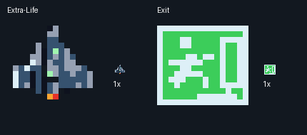

# Extra-Life und Exit, Shop Stage 3b

Beide Icons sind exakt 16×16 RGBA-Pixel ohne Kantenglättung. Unter
`assets/art/shop/generated/` liegen Einzel-PNGs, JSON-Pixelzeilen und Manifest.
Reproduktion: `python tools/design_shop_extras.py`.

Extra-Life verwendet den tatsächlichen Player, erster 32×24-Frame aus
`source/player-reference.png`. Die Datei stammt unverändert aus
`assets/art/spec-v2/generated/player.png` bei Commit
`ea3d8458033c2db342eec3b93f099bae3cf2e6d7`; ihr Hash steht im Manifest.
Der transparente Rand wird entfernt, das Motiv proportional mit Nearest Neighbour
in 14×14 eingepasst und zentriert. Farben werden auf erlaubte HUD-Farben abgebildet.
Es ist eine Miniatur des vorhandenen Sprites, keine neue Flugzeugvariante.
Bei späteren Player-Änderungen die Referenz bewusst aktualisieren.

Exit ist eine neue Pixelzeichnung: laufende Figur, Tür und Pfeil auf grünem
Grund nach dem gewünschten Notausgangs-Motiv. Es ist eine Spielgrafik und keine
normgeprüfte Sicherheitsbeschilderung.

Nur HUD-Indizes 1–8 und 10 plus transparenter Index 0. `tools/make_shop.py`
bildet sie mit `ICON_HUD_MAP` auf erlaubte Shop-Indizes 9–15 sowie 2,5,8 ab.
Transparent wird zum Zellenhintergrund 8; in deckenden Shop-Glyphen bleibt
Index 0 unbenutzt. Palette, Preise, Codes, Zellengrößen und Laufzeitlogik sind gleich.

`python tools/check_shop_extras.py` prüft Palette, Alpha, Pixelzeilen, echten
Importweg und Rückdekodierung aller drei SHOP-Tokenbilder. Ausgabe: 148/255 Glyphen.
Vollständiger Spielbuild erfolgreich; kein neuer Emulator- oder Hardwaretest.
Die kombinierte Shop-Vorschau zeigt Extra-Life auch automatisch abgedunkelt.
