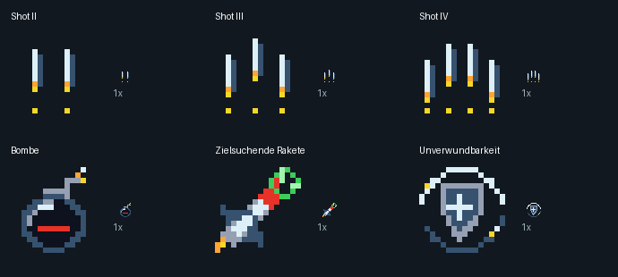

# Shop-Upgrades – native 16×16-Pixelgrafik

Sechs statische Icons für den späteren Shop. Der Spielcode und vorhandene
Builds bleiben unverändert. Noch nicht im Shop integriert, im Emulator oder
auf MEGA65-Hardware getestet.



| Index | ID | Motiv |
|---|---|---|
| 0 | `shot_ii` | Zwei helle Schussbahnen, zwei gelbe Rangpunkte |
| 1 | `shot_iii` | Drei helle Schussbahnen, drei Rangpunkte |
| 2 | `shot_iv` | Vier helle Schussbahnen, vier Rangpunkte |
| 3 | `bomb` | Runde dunkle Bombe mit Zündschnur und rotem Band |
| 4 | `homing_missile` | Rakete mit grüner Zielmarkierung |
| 5 | `invulnerability` | Mittelalterlicher Schild mit Schutzring |

Die Schussmuster dienen der Unterscheidung der Upgrade-Stufen; sie legen keine
Waffenmechanik fest. Der Schutzring unterscheidet Unverwundbarkeit vom
bisherigen Schild-Pickup. Namen, Preise und Auswahlrahmen zeichnet der Shop
separat. Es sind keine Beschriftungen in die 16×16-Nutzgrafik eingebrannt.

## Palette und Herkunft

Alle Icons verwenden dieselbe bestehende `HUD_PAL` aus `tools/import_art.py`,
geprüft gegen Stage-3-Commit `07dce498c2f211cd00fc6f1a4af65782abe6e8a7`.
Text-Palettenbank 12, Colour-RAM-Wert `$cf`; Index 0 ist transparent.
Es wird keine zusätzliche Palettenbank benötigt. Vor Integration prüfen,
ob diese Bank im aktuellen Build weiterhin dieselben Farben enthält.

Die Grafik ist neu und direkt auf dem nativen Pixelraster konstruiert,
keine automatische Verkleinerung des Referenzboards und kein Extrakt eines
KI-Posters. Quelldaten sind `source/icons.json` (Palette und Reihenfolge)
und die ganzzahligen Zeichenoperationen in `tools/export_shop_icons.py`.
`generated/indexed-source.json` enthält zusätzlich alle Pixel als Hex-Zeilen.
PNG-Transparenz ist binär, ohne Kantenglättung.

## Dateien und Export

Im Verzeichnis `assets/art/shop-upgrades/generated/` liegen sechs Einzel-PNGs,
ein Streifen mit 96×16 und ein Atlas mit 48×32 Pixeln. Die Reihenfolge entspricht
der Tabelle; beim Atlas links nach rechts, dann nächste Zeile.

| Datei | Bytes | Aufbau |
|---|---:|---|
| `shop.indices.bin` | 1536 | 6 Frames, je 256 Indizes, zeilenweise |
| `shop.ncm.bin` | 768 | Je Frame zwei 16×8-Glyphen, oben/unten; linkes Pixel im LOW-Nibble |
| `shop.fcm.bin` | 1536 | Je Frame vier 8×8-Glyphen, zeilenweise Tile-Reihenfolge |
| `shop.rrb.bin` | 1216 | 19 NCM-Glyphen: Leerzeichen, dann je Icon oben/unten/Leerzeichen |
| `palette.rgb` | 48 | 16 RGB-Tripel, je Kanal 8 Bit |
| `palette.palregs.bin` | 48 | R-, G-, B-Ebenen mit getauschten Nibbles |

`shop-icons.inc` enthält **lokale** RRB-Basen 1,4,7,10,13,16, Breite 1,
Höhe 2 und Palettenwert `$cf`. Beim späteren Anhängen an einen bestehenden
Zeichensatz müssen die Basen um dessen Glyphenoffset verschoben werden.
FCM ist eine alternative Datenablage und nutzt diese NCM-Tabellen nicht.
Ein Import darf die vorhandenen Glyphen und belegten Paletten nicht ersetzen.

```text
python -m pip install -r tools/shop-art-requirements.txt
python tools/export_shop_icons.py
python tools/check_shop_icons.py
```

Die Prüfung dekodiert NCM, FCM und RRB unabhängig zurück zu Pixeln,
prüft Palette, Transparenz, Dimensionen, Rangpunkte, Atlas und Prüfsummen.
Das bestätigt die Datenkonsistenz, ersetzt aber keinen Test der späteren
Shop-Integration auf dem Zielsystem.
